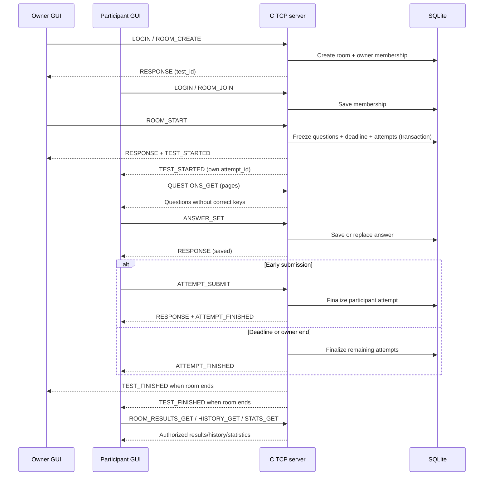

# Application-Layer Protocol — Design Baseline

## 1. Transport, framing, and limits

Use a persistent TCP connection with UTF-8 JSON Lines. Each physical message is
one compact JSON object followed by one LF byte (`0x0A`). A visible `\n` in slide
examples denotes that byte, not two characters sent after the JSON. Newlines in
JSON strings must be escaped. The receiver buffers partial reads and processes
all complete lines; the sender handles partial writes with `send_all()`.

The maximum encoded line is 65,536 bytes excluding LF. An oversized frame causes
`FRAME_TOO_LARGE` and connection closure. An invalid JSON line returns
`INVALID_JSON`; other well-framed request errors keep the connection open.
Handlers validate required fields and their types.

Limits: question count 1–100; duration 60–7,200 seconds; room members at most 50;
title at most 128 UTF-8 bytes; prompt at most 2,048 bytes; each of four choice
texts at most 512 bytes. Question pages contain at most five questions. Other
lists use offset/limit pagination, default 20 and maximum 50. This bounds frames
without putting a complete 100-question test into one message.

## 2. Envelopes and identity

Request IDs are positive integers, unique among outstanding requests on a
connection. TCP request order is preserved. IDs correlate responses; they are
not authorization tokens or durable retry keys.

```json
{"type":"LOGIN","request_id":1,"data":{"username":"student","password":"example-password"}}
{"type":"RESPONSE","request_id":1,"ok":true,"data":{"user":{"id":7,"username":"student"},"expires_at":1792486800}}
{"type":"RESPONSE","request_id":2,"ok":false,"error":{"code":"ROOM_ALREADY_STARTED","message":"The room is not open for joining"}}
{"type":"EVENT","event":"TEST_FINISHED","data":{"test_id":41,"reason":"TIMEOUT"}}
```

Each line above is a separate LF-terminated message. Events are unsolicited and
have no request ID. Every ordinary response uses `RESPONSE` and the same
success/error envelope, regardless of the command.

Successful login binds the account/session to that socket. No user ID supplied
in later request data overrides the authenticated connection. Logout, disconnect,
or eight-hour expiry ends that session. The server serializes sends so an
asynchronous event cannot split another message's bytes.

## 3. Command catalogue

IDs are positive SQLite integer identifiers. Timestamps are UTC Unix seconds.
`page` means `{offset,limit}`. Responses may add `server_time` for countdowns.

| Command | Request data | Successful response data / access |
| --- | --- | --- |
| REGISTER | username, password | user ID/username; does not log in; public |
| LOGIN | username, password | user, expires_at; public; rejects a second active login |
| LOGOUT | empty | logged_out=true; authenticated |
| ACCOUNT_GET | empty | own user ID/username/created_at |
| PASSWORD_CHANGE | old_password, new_password | changed=true; verify old password |
| QUESTION_FILTERS_GET | page | topics plus EASY/MEDIUM/HARD; authenticated |
| ROOM_CREATE | title, question_count, duration_seconds, topic_ids[], difficulties[] | room summary; owner automatically joins |
| ROOM_LIST | status or null, page | room summaries, total; excludes PRACTICE tests |
| ROOM_GET | test_id | room summary and members; authenticated |
| ROOM_JOIN | test_id | membership and room; only NOT_STARTED; repeated join returns existing membership |
| ROOM_LEAVE | test_id | left=true; non-owner member; only NOT_STARTED |
| ROOM_START | test_id | room/deadline; owner only; creates attempts atomically |
| ROOM_END | test_id | finished room; owner only; finalizes outstanding attempts |
| PRACTICE_START | question_count, duration_seconds, topic_ids[], difficulties[] | test_id, attempt_id, question_count, deadline_at |
| ATTEMPT_CURRENT | empty | own IN_PROGRESS attempt summary or null |
| QUESTIONS_GET | attempt_id, offset, limit<=5 | question page, total, selected choices; own attempt only; never includes correct keys |
| ANSWER_SET | attempt_id, question_id, choice_key (A–D or null) | saved choice or cleared=true; own active attempt before deadline |
| ATTEMPT_SUBMIT | attempt_id | final result; own attempt; repeats return the saved final result |
| ATTEMPT_RESULT_GET | attempt_id | own finalized result; otherwise ATTEMPT_NOT_FINISHED |
| ROOM_RESULTS_GET | test_id, page | finalized member scoreboard; members only; room must be FINISHED |
| HISTORY_GET | mode or null, from/to or null, page | own finalized attempt summaries, total |
| STATS_GET | mode or null, from/to or null, topic_page | own completed_count, total_correct, total_questions, accuracy_percent, latest<=50 progress points, paged by_topic/topic_total, by_difficulty |

Every command except REGISTER/LOGIN requires a valid connection session. Empty
topic/difficulty lists mean all. Selected topics and difficulties are applied
together. Registration accepts usernames of 3–32 ASCII letters/digits/underscores
and passwords of 8–128 UTF-8 bytes. Passwords never appear in response/event data.

A question is `{id,ordinal,prompt,topic_id,difficulty,choices:[{key,text}]}`.
A result is `{attempt_id,test_id,mode,status,correct_count,question_count,
percentage,finalized_at}`. A room summary includes owner, title, status, count,
duration, member_count, filters, and start/deadline/finish timestamps.
An empty history returns empty arrays, completed_count=0, and accuracy_percent=null.
Date filters use an inclusive `from` and exclusive `to`; if both are provided,
`to` must be greater than `from`.
Ending an already finished room returns its saved final summary; ending a room
that has not started returns ROOM_NOT_STARTED.

## 4. Server events

| Event | Data and recipient |
| --- | --- |
| ROOM_STATE | test_id, status, member_count; connected members after membership/state changes |
| TEST_STARTED | test_id, own attempt_id, question_count, deadline_at, server_time; each connected member |
| ATTEMPT_FINISHED | final result; affected connected user after submission, expiry, or owner-end |
| TEST_FINISHED | test_id, reason; connected room members |
| SESSION_EXPIRED | expiry reason; affected connection becomes unauthenticated |

The start event supplies IDs/deadline, not the entire question bank. The GUI
fetches question pages. Login followed by `ATTEMPT_CURRENT` retrieves state after
a disconnect. Final responses/events can contain the same result; the GUI
updates by attempt ID and treats a finalized result as immutable.

## 5. Main sequence



Practice uses `PRACTICE_START → QUESTIONS_GET → ANSWER_SET → ATTEMPT_SUBMIT`,
or deadline finalization. The same attempt service performs scoring.

## 6. State, authorization, and errors

Room states are `NOT_STARTED`, `ONGOING`, `FINISHED`. Attempt states are
`IN_PROGRESS`, `SUBMITTED`, `EXPIRED`, `ENDED_BY_OWNER`. Submitting one attempt
does not end another participant's attempt. All-submitted, timeout, or owner-end
finishes the room. At `now >= deadline_at`, answer changes are rejected even if
the deadline scheduler has not yet run. All finalization routes are transactional.

Error codes include `INVALID_JSON`, `FRAME_TOO_LARGE`, `UNKNOWN_COMMAND`,
`INVALID_ARGUMENT`, `USERNAME_TAKEN`, `INVALID_CREDENTIALS`, `ALREADY_LOGGED_IN`,
`AUTH_REQUIRED`, `SESSION_EXPIRED`, `FORBIDDEN`, `NOT_FOUND`, `ROOM_FULL`,
`ROOM_ALREADY_STARTED`, `ROOM_NOT_STARTED`, `ROOM_NOT_FINISHED`,
`PARTICIPANT_BUSY`, `INSUFFICIENT_QUESTIONS`, `QUESTION_NOT_IN_TEST`,
`INVALID_CHOICE`, `ATTEMPT_FINISHED`, `ATTEMPT_NOT_FINISHED`, and
`DEADLINE_PASSED`. Clients branch on codes rather than explanatory error messages.

The first deployment is a controlled classroom/LAN application using plain TCP.
Password hashing protects stored passwords, not bytes on the network. The
presentation must not claim encrypted transport.
