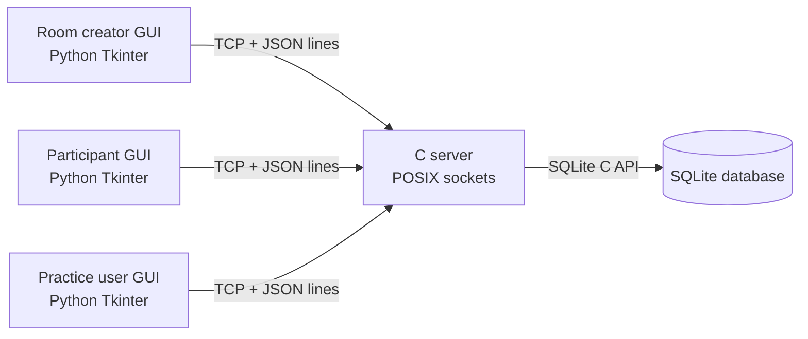

# Preliminary System Architecture

## Architecture decision

- **Server:** C with POSIX TCP sockets and a threaded client model.
- **Client GUI:** Python 3 with Tkinter; it connects directly to the C server.
- **Application messages:** newline-delimited JSON over TCP. The C server owns
  stream buffering and handles partial reads/writes.
- **Persistence:** SQLite, accessed by the C server through its C API.
- **Password storage:** libsodium Argon2id password hashes.
- **Development:** a project-local Docker Compose environment. It does not
  change the existing workspace Dev Container.

The first implementation prioritizes a clear client/server boundary. The
server remains authoritative for authentication, access checks, room status,
deadlines, submitted answers, and scoring. The GUI only displays server state
and sends user actions.

## Component view

## Main server responsibilities

1. Accept TCP connections and create a session for each connected client.
2. Authenticate accounts and enforce room/participant permissions.
3. Manage test-room states: `NOT_STARTED`, `ONGOING`, and `FINISHED`.
4. Select questions using the requested count, difficulty, and topic filters.
5. Start and end tests using server-side timestamps; client clocks are not trusted.
6. Save or replace answers while a test is open, then score on early submission
   or when time expires.
7. Store attempts and activity records for history and statistics.

## Detailed design documents

- [Functional design](functional-design.md): all required flows, permissions,
  lifecycle rules, deadlines, scoring, GUI screens, and failure behavior.
- [Data model](data-model.md): ERD and table/constraint responsibilities.
- [SQLite schema](../server/schema.sql): concrete tables, keys, checks, and indexes.
- [Application protocol](application-protocol.md): command catalogue, response/event
  envelopes, limits, permissions, errors, and the test sequence.

Test Mode and Practice share `tests`, `test_questions`, `attempts`, and `answers`.
One room has many participants' attempts; one practice test has one attempt.
The threaded server uses a service mutex for state/write transactions, a deadline
scheduler, and per-connection send locks. SQLite state is committed before
acknowledgement; network writes happen outside the service mutex.
