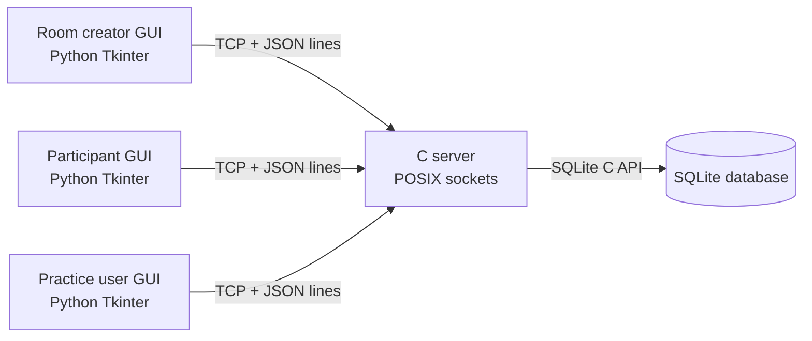

# Preliminary System Architecture

## Architecture decision

- **Server:** C with POSIX TCP sockets and a threaded client model.
- **Client GUI:** Python 3 with Tkinter; it connects directly to the C server.
- **Application messages:** newline-delimited JSON over TCP. The C server owns
  stream buffering and handles partial reads/writes.
- **Persistence:** SQLite, accessed by the C server through its C API.
- **Development:** a project-local Docker Compose environment. It does not
  change the existing workspace Dev Container.

The first implementation prioritizes a clear client/server boundary. The
server remains authoritative for authentication, access checks, room status,
deadlines, submitted answers, and scoring. The GUI only displays server state
and sends user actions.

## Component view

## Main server responsibilities

1. Accept TCP connections and create a session for each connected client.
2. Authenticate accounts and enforce room/participant permissions.
3. Manage test-room states: `NOT_STARTED`, `ONGOING`, and `FINISHED`.
4. Select questions using the requested count, difficulty, and topic filters.
5. Start and end tests using server-side timestamps; client clocks are not trusted.
6. Save or replace answers while a test is open, then score on early submission
   or when time expires.
7. Store attempts and activity records for history and statistics.

## Initial data model

- `users`: account name, password hash, creation time.
- `questions`: prompt, four or more choices, correct choice, difficulty, topic.
- `rooms`: owner, state, question count, duration, timestamps, filters.
- `room_members`: room, user, join time, final score.
- `room_questions`: selected question order for each room/attempt.
- `answers`: selected choice per participant and question.
- `practice_attempts`: settings, timestamps, score, and selected questions.
- `activity_log`: actor, action, target, and timestamp.

The schema is preliminary and will be revised after the first server prototype.
