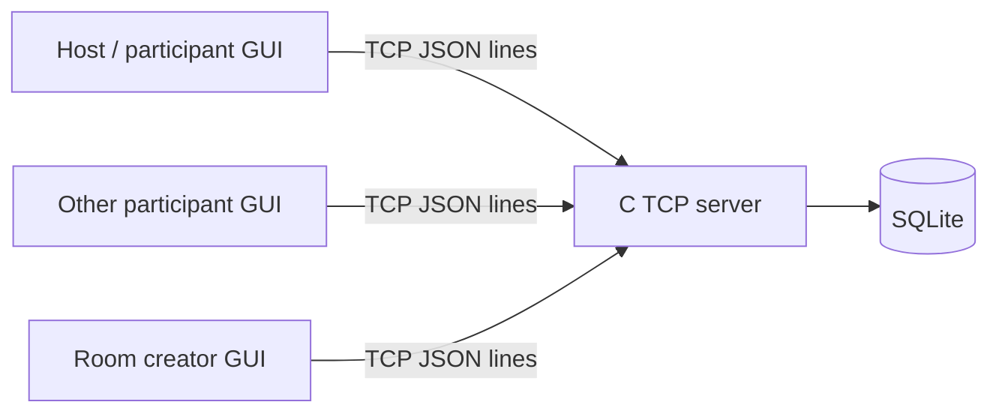

# Checkpoint 1 – Progress Presentation

**Project:** Online Multiple-Choice Testing Application

**Checkpoint:** Week 7, October 20, 2026 (tentative schedule also lists October 27)

**Presentation limit:** 10 minutes

## 1. Topic and objectives

We plan to build a client/server application for timed multiple-choice tests and
practice quizzes. The project will demonstrate TCP stream handling, a
well-defined application protocol, multi-client room management, persistence,
and a graphical client.

## 2. Proposed environment and tools

- C (POSIX sockets, pthreads, SQLite C API, cJSON) for the server.
- Python 3 and Tkinter for the desktop GUI client.
- TCP with newline-delimited JSON application messages.
- Docker Compose for a repeatable Linux C server development environment.
- Git for source control; Make for building and routine checks.

The GUI client connects directly to the C server; there is no HTTP or WebSocket
gateway.

## 3. Preliminary architecture

The server owns room state, deadlines, answer validation, access control, and
scoring. The GUI renders state received from the server. See
[`architecture.md`](architecture.md).

## 4. Planned functionality

### Core scope

- Registration, login, session handling, and access checks.
- Create a test room, choose question count/duration, and start/end it.
- List rooms and show `NOT_STARTED`, `ONGOING`, or `FINISHED` status.
- Join before start; receive questions when the test starts.
- Save/change answers before submission or deadline.
- Submit early; automatically score and notify participants at the deadline.
- Practice tests with selected count/duration and immediate result.
- View results for completed rooms and personal attempt history.
- Record important account, room, and test activity.

### Extension scope if time permits

- Difficulty and topic filters.
- Graphical score/history statistics.
- Question import/export and additional validation.
- Reconnection support and a more detailed activity audit.

## 5. Application-layer protocol

One JSON object plus newline is one application message. The server buffers TCP
data until a complete line is received and handles partial sends. Messages have
`type`, `request_id`, and `data`; responses include `ok` and an error code when
needed. The initial message catalogue includes `REGISTER`, `LOGIN`,
`ROOM_CREATE`, `ROOM_LIST`, `ROOM_JOIN`, `ROOM_START`, `ANSWER_SET`,
`TEST_SUBMIT`, `PRACTICE_START`, `HISTORY_GET`, and `STATS_GET`. Details are in
[`application-protocol.md`](application-protocol.md).

## 6. Proposed task allocation

Fill in member names after group registration. The roles can be combined or
split based on the final group size.

| Member | Proposed responsibility |
| --- | --- |
| Member 1: `[name]` | C socket server, framing, connection/session handling |
| Member 2: `[name]` | Accounts, SQLite schema, access control, activity log |
| Member 3: `[name]` | Tkinter GUI, room and test screens, client protocol integration |
| Member 4: `[name]` | Practice/history/statistics, test cases, integration and presentation |

## 7. Current progress

- Created a project directory separate from the existing homework source.
- Prepared a project-specific Docker Compose development environment.
- Drafted the system architecture and application-layer protocol.
- Mapped the requested features to an initial implementation scope.
- Server, GUI, database schema, and end-to-end behavior have **not yet been
  implemented**.

## 8. Next milestones

1. Confirm the group and replace the task-allocation placeholders.
2. Implement TCP framing and a minimal request/response round trip.
3. Add account registration/login and persistent question data.
4. Implement practice mode, then test-room lifecycle and scoring.
5. Connect the GUI, add history/statistics, and perform multi-client tests.

## 9. Point-allocation note

The proposed core emphasizes stream handling, server socket I/O, accounts,
sessions/access control, practice mode, and test-room flows. The Tkinter client
is intended to address the GUI category. Difficulty/topic customization and
statistics are planned extensions. The grading outcome depends on the final
implementation and demonstration.
