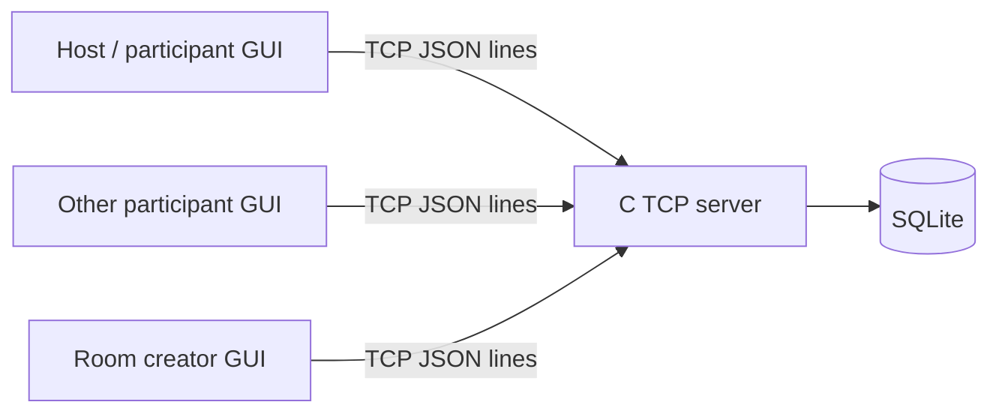

# Checkpoint 1 – Progress Presentation

**Project:** Online Multiple-Choice Testing Application

**Checkpoint:** Week 7, October 20, 2026 (tentative schedule also lists October 27)

**Presentation target:** 15 minutes, following the group's updated presentation slot.

## 1. Topic and objectives

We plan to build a client/server application for timed multiple-choice tests and
practice quizzes. The project will demonstrate TCP stream handling, a
well-defined application protocol, multi-client room management, persistence,
and a graphical client.

## 2. Proposed environment and tools

- C (POSIX sockets, pthreads, SQLite C API, cJSON, libsodium) for the server.
- Python 3 and Tkinter for the desktop GUI client.
- TCP with newline-delimited JSON application messages.
- Docker Compose for a repeatable Linux C server development environment.
- Git for source control; Make for building and routine checks.

The GUI client connects directly to the C server; there is no HTTP or WebSocket
gateway.

## 3. Preliminary architecture

The server owns room state, deadlines, answer validation, access control, and
scoring. The GUI renders state received from the server. See
[`architecture.md`](architecture.md).

## 4. Planned functionality

### Required functionality

- Registration, login, session handling, and access checks.
- Create a test room, choose question count/duration, and start/end it.
- List rooms and show `NOT_STARTED`, `ONGOING`, or `FINISHED` status.
- Join before start; receive questions when the test starts.
- Save/change answers before submission or deadline.
- Submit early; automatically score and notify participants at the deadline.
- Practice tests with selected count/duration and immediate result.
- View results for completed rooms and personal attempt history.
- Record important account, room, and test activity.
- Difficulty and topic filters.
- Graphical score/history statistics.
- A graphical user interface for both modes and result/history views.

## 5. Application-layer protocol

One JSON object plus newline is one application message. The server buffers TCP
data until a complete line is received and handles partial sends. Messages have
`type`, `request_id`, and `data`; responses include `ok` and an error code when
needed. The initial message catalogue includes `REGISTER`, `LOGIN`,
`ROOM_CREATE`, `ROOM_LIST`, `ROOM_JOIN`, `ROOM_START`, `ANSWER_SET`,
`ATTEMPT_SUBMIT`, `PRACTICE_START`, `HISTORY_GET`, and `STATS_GET`. Details are in
[`application-protocol.md`](application-protocol.md).

The full design also specifies connection-bound sessions, answer ownership,
question pagination, asynchronous server events, error codes, and deadline
validation. Start/end, submit, and timeout update persistent state transactionally.

### Data model and functional flows

[functional-design.md](functional-design.md) defines all required flows and edge
cases. [data-model.md](data-model.md) contains the ERD, and
[server/schema.sql](../server/schema.sql) contains the proposed SQLite tables,
keys, constraints, and indexes. A shared test definition has one attempt per
member; Practice Mode uses the same entities with one member.

## 6. Proposed task allocation

| Member | Proposed responsibility |
| --- | --- |
| Trần Hữu Đức (`20225963`) | C TCP socket handling, message framing, multi-client connections, and test-room lifecycle/timers |
| Trần Anh Dũng (`20226031`) | Project lead; coordinate scope and architecture, maintain the protocol contract, integrate modules, and lead the final demo |
| Trần Cao Phong (`20226061`) | Account registration/login, sessions and access control, SQLite schema/persistence, and activity logging |
| Lê Diễm Hằng (`20225970`) | Tkinter GUI and client integration, practice/history/statistics screens, and end-to-end test scenarios |

## 7. Current progress

- Created a project directory separate from the existing homework source.
- Prepared a project-specific Docker Compose development environment.
- Documented all required functional flows and the initial GUI screen plan.
- Designed the ERD, concrete SQLite schema, and application-layer protocol.
- Added schema checks for key relationships and scoring-query examples.
- C server handlers, GUI, and end-to-end application behavior are **not yet
  implemented**. Schema validation is not an end-to-end application test.

## 8. Next milestones

1. Implement TCP framing and a minimal request/response round trip.
2. Implement accounts/sessions and seed the question bank.
3. Build shared attempt/answer/scoring services and Practice Mode.
4. Add room membership, owner controls, delivery, and deadline finalization.
5. Integrate GUI, history/statistics, activity logging, and multi-client tests.

## 9. Required delivery scope

The delivery scope includes stream handling, server socket I/O, accounts,
sessions/access control, activity logging, both test modes, difficulty/topic
customization, persistent test history, graphical statistics, and the Tkinter
GUI. All specified functions are required deliverables.

## 10. Suggested presentation timing

| Slides | Focus | Time |
| --- | --- | --- |
| 1–3 | Topic, full feature scope, tools, and architecture | 3 min |
| 4–7 | Framing, commands/access, room/practice flow, and message sequence | 4 min |
| 8–9 | Data model and why tests/attempts are separate | 3 min |
| 10–11 | Filters/history/statistics, team, progress, and next steps | 3 min |
| Discussion | Questions and feedback | 2 min |

The main presentation takes about 13 minutes. Each slide keeps only its key
points; detailed fields, constraints, and edge cases stay in the linked documents.
