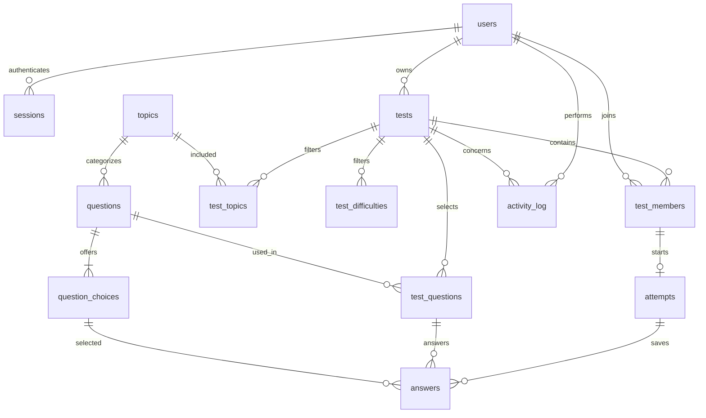

# Data Model and ERD

The executable SQLite schema is [`../server/schema.sql`](../server/schema.sql).
This is the proposed design for the full required feature set. Application
handlers and migrations are not implemented yet. All timestamps are UTC Unix
seconds; SQLite foreign-key enforcement is enabled on every connection.

## Relationship diagram

## Tables and purposes

| Table | Key fields and rules |
| --- | --- |
| users | Unique case-insensitive username; salted password hash; created_at |
| sessions | user_id, expiry, end time/reason; one open connection session per user |
| topics | Unique topic name |
| questions | topic_id, difficulty, prompt, correct_choice_key, active flag |
| question_choices | Composite key (question_id, choice_key); choices A–D |
| tests | ROOM/PRACTICE, owner, settings, lifecycle, start/deadline/finish, end reason |
| test_topics / test_difficulties | Allowed filter sets; no rows means all values |
| test_members | Unique membership per (test_id, user_id), joined_at |
| test_questions | Fixed selected questions; unique question and ordinal per test |
| attempts | One attempt per member; status, start/finalization, correct_count |
| answers | One saved choice per attempt/question; update replaces it; delete clears it |
| activity_log | Actor/test, action, outcome, timestamp; no credentials or answer keys |

## Why both tests and attempts?

A `test` stores shared settings, questions, and deadline. An `attempt` stores one
user's work/result. A room may have many attempts; a private practice test has
one. Early submission changes only that attempt. Room completion finalizes the
remaining attempts. Therefore an attempt score is not stored on membership.

## Integrity rules

SQLite enforces user/topic uniqueness, membership uniqueness, one attempt per
member, valid states/difficulties/choices, and the relationships in the schema.
The answer table's composite foreign keys ensure the question belongs to that
attempt's test and the selected choice belongs to that question. The correct key
references an existing choice through a deferred foreign key, allowing question
and choices to be inserted together in one transaction.

The service layer additionally enforces:

- Exactly four choices and one correct key for a usable question.
- No edits/deletion of question content or choices once used by a test.
- Exactly the requested number of distinct selected questions before start.
- The owner is a member; practice has only its owner as member.
- Membership changes only before start; timestamps/deadline are set by server.
- Answer changes only while an attempt is in progress and before the deadline.
- Finalization calculates `0 <= correct_count <= question_count` exactly once.
- State updates, selected questions, attempts, scores, and activity writes are
  committed atomically for the corresponding operation.

These checks depend on multiple rows/current time and are intentionally listed
as service responsibilities rather than being claimed as SQL CHECK constraints.

## Statistics queries

History joins `attempts`, `tests`, and `users`, filtering finalized attempts by
the authenticated user. Overall accuracy divides total correct answers by the
total selected question count. Topic/difficulty accuracy joins `test_questions`
and `questions` with the user's `answers`; a left join includes unanswered
questions as incorrect. Statistics are derived from these records, not stored
as independently mutable totals.
